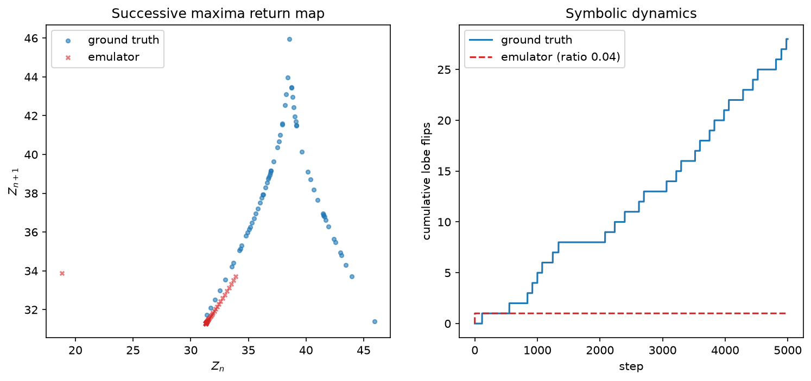
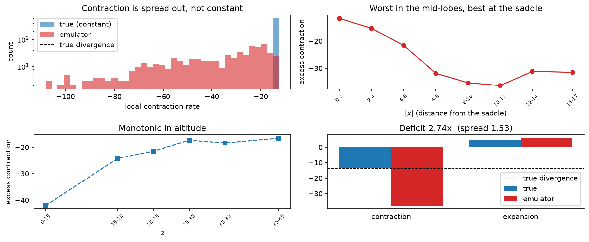

# Predicting the Wrong Thing Correctly

### Evaluating machine-learning emulators of chaotic systems by the dynamics they preserve, not the forecasts they make

**A research software paper on the `lorenz63` package**

---

## Abstract

Machine-learning "emulators" are increasingly used as cheap stand-ins for expensive physical
simulations. The standard way to train and judge them is forecast error: how close is the
predicted next state to the true next state? This paper reports a case where that measure is
actively misleading.

We study a neural network trained to emulate the Lorenz-63 system, the canonical model of
deterministic chaos. We show that a model with near-optimal one-step prediction error **0.112**
has, in a meaningful sense, learned no dynamics at all: its trajectories collapse onto a fixed
point, its attractor has half the correct geometric dimension, and the rate at which it loses
volume is **22 times too large**. Forecast error does not notice.

We then build the measurement infrastructure needed to see this. The package implements eight
diagnostics that characterise an emulator by *dynamical invariants* — how fast nearby
trajectories separate, how much volume it contracts, what shape its attractor has, and how often
it switches between the system's two lobes. Two design decisions make the numbers interpretable:
(1) every metric is computed identically for a second *true* trajectory and for a deliberately
trivial model, giving each number a ceiling and a floor; and (2) every experiment is repeated with
five independent random seeds, so a difference can be compared against the noise rather than
assumed real. The second decision forced us to **retract two of our own earlier claims**.

The central finding is that the emulator's failure is concentrated in a *tail* of states. The
typical state contracts only 1.16× too fast, while the worst 5% contract **6.4×** too fast. A
metric reporting only the average would have hidden this. We trace the cause to a structural
weakness of the standard approach: an emulator that learns the one-step *map*
`x → f(x)` has nothing in its training signal that constrains how it changes volume, because the
volume change enters the prediction only at second order in the timestep — invisible at the
resolutions used in practice.

Finally we test a repair. An alternative parameterisation that learns the underlying *velocity
field* `dx/dt = g(x)` and integrates it also fails, and for an instructive reason. But because the
field exposes the volume change as a cheap derivative of its own output, it can be penalised
directly. With the known volume-change rate added to the loss, the emulator's contraction
accuracy improves from **4.6× wrong to 0.8% wrong**, at a cost of about 30% in forecast error.
The lesson is not that one parameterisation is better, but that **a quantity you cannot measure
inside the model, you cannot control**.

All code, data and results are in this repository, and everything runs on a laptop CPU.

---

## 1. Introduction

### 1.1 The problem in one paragraph

Some physical systems are *chaotic*: they obey exact, simple laws, yet two runs started from
almost identical conditions drift apart exponentially. Weather is the standard example. This makes
long-range prediction impossible in principle, not just difficult in practice. The practical
response has been to accept short-range predictions and try to get the *statistics* right — the
climate rather than the weather.

Machine-learning emulators have become a popular way to do this cheaply. A neural network is
trained on examples of a simulation and then used in its place, often 1000× faster. The field's
standard quality measure is **forecast error**: average squared distance between the emulator's
predicted next state and the true one.

This paper is about a specific worry: **that forecast error can be excellent while the emulator has
learned something with qualitatively wrong behaviour.** We construct a demonstration where this
happens, build the tools to detect it, and investigate the cause.

### 1.2 Why this is not a hypothetical

Our strongest example is an emulator whose one-step error is 0.112 on a system whose states span
roughly ±20. That is a good number by any normal standard. Yet the same emulator, when rolled
forward, produces a trajectory that contracts to a point rather than exploring the attractor.

The intuition for how this happens: chaos means errors grow and trajectories diverge. A model can
achieve a low *average* error not by predicting correctly but by predicting *conservatively* —
outputting something close to the average of what could happen. In a chaotic system, the
"conservative" answer is close to the average of the attractor, which is exactly the sort of
prediction that shrinks the dynamics. Forecast error rewards this; nothing in the objective
punishes it.

### 1.3 Thesis

> **An emulator of a chaotic system must be evaluated on the dynamical invariants it preserves,
> not on the forecasts it makes. These two can be almost perfectly decoupled, and when they are,
> only the invariants reveal it.**

A secondary thesis follows from the results:

> **The invariants that matter most are the ones the training signal cannot see. Whether an
> emulator can be repaired depends on whether the architecture exposes those invariants to the
> loss.**

### 1.4 Contributions

1. A demonstration of complete decoupling between forecast accuracy and dynamical fidelity
   (§4.1), with the numbers to make it concrete.
2. A measurement suite of eight diagnostics (§3.3), each given a ceiling and a floor by explicit
   control experiments (§3.5) — without which none of the numbers would be interpretable.
3. A **resolvability screen** (§3.6) that separates real differences between configurations from
   seed-to-seed noise. Applying it forced us to retract two prior claims (§4.2).
4. A localisation result: the failure is a **tail phenomenon**, not a uniform bias (§4.3).
5. A mechanistic explanation — the volume-change rate is invisible to a one-step training signal
   at practical timesteps (§5.1) — and a working repair (§4.4, §5.2).
6. A documented set of implementation errors found and fixed along the way (§6), several of which
   had previously produced entirely spurious results.

---

## 2. Background for non-specialists

This section assumes no physics. Each idea is introduced with the intuition first.

### 2.1 The Lorenz-63 system

In 1963 Edward Lorenz distilled atmospheric convection into three coupled equations:

```
dx/dt = σ (y − x)
dy/dt = x (ρ − z) − y
dz/dt = x y − β z
```

with the standard parameters `σ = 10`, `ρ = 28`, `β = 8/3`. The variables `x`, `y`, `z` are not
positions in physical space; they are abstract amplitudes (roughly, temperature contrasts and
circulation strength). We use them simply as a three-dimensional test system with the right
mathematical character and a known exact answer.

The equations say: *the rate of change of each variable is a simple function of the current
state*. There is no randomness anywhere. Yet the resulting motion is chaotic.

### 2.2 Attractors

Plot the trajectory over a long time and you do not get a filled blob or a wandering path. You get
a specific, intricate shape that the motion traces forever: the **attractor**. Lorenz's is the
famous two-lobed "butterfly".

Two points about this matter for everything that follows:

* **The shape is stable.** Although individual trajectories are unpredictable, the region they
  occupy is perfectly reproducible. This is why climate statistics are meaningful even though
  weather forecasts are not.
* **The shape is complicated.** It has a fractional ("fractal") dimension slightly above 2 — more
  than a surface, less than a solid.

### 2.3 Chaotic means "sensitive to initial conditions"

Start two runs a hair apart. The separation grows exponentially:

```
separation(t) ≈ separation(0) × e^(λ t)
```

The **Lyapunov exponent** `λ` is the growth rate. A positive `λ` *is* the definition of chaos. For
Lorenz-63 the largest is `λ₁ ≈ 0.9` per unit time, so an initial separation of `10⁻⁵` is amplified
by a factor of about `e^(0.9 × 50) ≈ 10¹⁹` over 50 time units. Since the attractor is only about
40 units across, the two trajectories are effectively unrelated after roughly **one** time unit.
This is why pointwise forecast comparison is useless beyond a short horizon: the error saturates
at the size of the attractor and then merely fluctuates.

### 2.4 The Lyapunov spectrum: three numbers, not one

A three-dimensional system has three Lyapunov exponents, forming the **spectrum**. Each describes
how fast a small volume is stretched or squashed along one independent direction.

For Lorenz-63 the textbook values are roughly:

| exponent | value | meaning |
|---|---|---|
| `λ₁` | `+0.906` | fastest stretching — the chaos |
| `λ₂` | `0` | neutral: the direction along the flow |
| `λ₃` | `−14.57` | strong contraction |

`λ₂ ≈ 0` is not a coincidence; it holds for any smooth flow, because moving along a trajectory
costs nothing. This makes it a useful correctness check.

### 2.5 Volume contraction — the idea this paper turns on

Imagine a small blob of initial conditions. As the system evolves, the blob is stretched in some
directions and squashed in others. Its **volume** changes at a rate given by the *divergence* of
the equations, written `∇·f`.

For Lorenz-63 the divergence is a constant:

```
∇·f = −(σ + 1 + β) = −13.667   everywhere
```

The key consequence: the true system **destroys volume at exactly the same rate at every single
point in space, with no exceptions**. Stretching is wildly state-dependent, but the net
volume change is rigidly constant.

And the Lyapunov exponents must sum to that rate:

```
λ₁ + λ₂ + λ₃ = −13.667
```

Check against the table: `0.906 + 0 − 14.57 = −13.66`, which checks out.

This gives us a rare gift: a **known, exactly constant, local target**. If we measure how much
volume an emulator destroys at a particular state and compare it with `−13.667`, any discrepancy
is purely the emulator's error — we never have to ask whether the true system would have behaved
differently there.

We use this in §4.3 to locate exactly *where* the emulator goes wrong.

> **A note on signs.** "Contraction rate" below means the rate of change of log-volume,
> `d(ln V)/dt`, which equals `∇·f`. For Lorenz it is negative (volume shrinks). We sometimes
> report a **ratio** of the emulator's rate to the truth's. Both are negative, so a ratio above 1
> means the emulator contracts *faster* than it should, and a ratio below 1 means it contracts too
> slowly.

### 2.6 Two ways to build an emulator

This distinction is central to §4.4 and §5.

**The map approach.** Learn a function that takes the state now and returns the state one step
later:

```
x_(n+1) = f(x_n)
```

Training is simple and direct. But the volume change is an *emergent* property of the whole
network — the determinant of `f`'s derivative matrix. There is no single number you can point at
and say "this is the volume change".

**The field approach.** Learn the *velocity field* instead, then integrate it with a standard
numerical solver (here, classic fourth-order Runge–Kutta):

```
dx/dt = g(x)      →      x_(n+1) = RK4(g, x_n, Δt)
```

Now the volume change has a name: the divergence of `g`, `∇·g`. It is computable from `g`'s
output by a simple derivative. That makes it something you can *measure inside the model* — and
therefore something you can add to the loss.

---

## 3. What the software does

Everything is in the `lorenz63` Python package. It runs on a CPU with NumPy alone; an optional JAX
backend exists for speed.

### 3.1 Pipeline overview

The package is a straight line from generating data to reporting a number, with the controls
branching off in parallel at the measurement stage:

| Stage | Module | What it does |
|---|---|---|
| 1. Ground truth | [`system.py`](lorenz63/system.py) | Integrates the Lorenz equations with a fourth-order Runge–Kutta stepper; also supplies the exact derivative matrices the diagnostics compare against. |
| 2. Data | [`data.py`](lorenz63/data.py) | Cuts long trajectories into sliding windows `(x_n, x_(n+1), …)` and adds noise to the inputs only. |
| 3. Model | [`models.py`](lorenz63/models.py), [`field_models.py`](lorenz63/field_models.py) | The emulator itself: a map network or a velocity-field network. |
| 4. Training | [`train.py`](lorenz63/train.py), [`jax_trainer.py`](lorenz63/jax_trainer.py) | Adam with gradient clipping; one loss definition shared by both backends. |
| 5. Rollout | [`controls.py`](lorenz63/controls.py) | Runs the trained emulator forward, and separately builds the two control trajectories. |
| 6. Measurement | [`diagnostics/`](lorenz63/diagnostics) | Eight pure functions. They return numbers; they never plot and never decide pass or fail. |
| 7. Reporting | [`report.py`](lorenz63/report.py) | Builds the figures and `results.json`, and re-reads every image it writes to confirm it is not blank. |
| 8. Aggregation | [`aggregate.py`](lorenz63/aggregate.py) | Collapses the five seeds into means and spreads, and computes the pairwise resolvability verdicts. |

Two structural rules are enforced by tests rather than convention, because both were violated in
the original code:

* **Diagnostics never create figures.** Plotting lives only in `report.py`. A test parses the
  diagnostic modules and fails if any of them imports a plotting library.
* **Measurement and judgement are separate.** No diagnostic prints "PASS" or "FAIL"; deciding
  whether a difference is meaningful happens in `aggregate.py`, where the controls and seed
  spreads are visible.

### 3.2 The emulator

A small neural network ("multi-layer perceptron"): three inputs, three outputs, three hidden
layers of 128 units each, with a smooth activation function. **33,923 parameters.** Two variants
share this architecture exactly, so comparisons are parameter-for-parameter fair:

* [`models.py`](lorenz63/models.py) — `NumpyMLP`, the **map** emulator, plus an `IdentityModel`
  used as a deliberately useless control.
* [`field_models.py`](lorenz63/field_models.py) — `VectorFieldMLP`, the **field** emulator. Its
  `step()` integrates one Runge–Kutta step of the learned field, so it is interchangeable with
  the map everywhere downstream.

The field emulator's gradients pass *backwards through the integration*. That is unusual enough
that we check it against numerical finite differences rather than trusting it: agreement is
**1.9 × 10⁻¹⁰** ([`tests/test_field_models.py`](tests/test_field_models.py)).

### 3.3 The diagnostics

Each is a pure function `(ground_truth, emulator, context) → (true_metrics, emulator_metrics)`.
None of them plots anything, and none of them decides pass or fail — that separation is enforced
by a test, because it was the root cause of the original pipeline producing 28 completely blank
image files.

| Diagnostic | Plain-language question it answers |
|---|---|
| `lyapunov_spectrum` | How fast does it stretch and squash, versus the true rates? |
| `local_contraction` | **Where** does it get the volume change wrong, and does it stretch in the right places? |
| `error_growth` | How fast do two nearby trajectories separate, by a route independent of the spectrum? |
| `invariant_measure` | Does it spend its time in the same regions, with the same distribution? |
| `correlation_dimension` | Does its attractor have the right geometric dimension? |
| `symbolic_dynamics` | Does it switch between the two lobes as often as it should? |
| `dmd_spectrum` | Does its oscillation content match? |
| `vector_field_slice` | Does its local rule agree with the true one, away from where it was trained? |

`local_contraction` returns both the volume-change error and the local stretching rate, so the
eight modules yield nine reported quantities.

Note that `error_growth` estimates the largest Lyapunov exponent by a completely different route —
following two nearby trajectories — making it an **independent check** on the spectrum calculation
rather than a restatement of it. The two agree to within 8% on the well-behaved configurations.

The **self-check** design matters. The Lyapunov diagnostic reports two quantities that *must* hold
if the implementation is correct:

* `sum(λ) == ln|det A| / Δt`, exactly, where `A` is the one-step flow Jacobian; and
* to leading order, that equals the constant divergence `−13.667`.

If either fails, the diagnostic is wrong and we know before drawing any conclusion. In our runs
`sum(λ)` matches the reference to **five decimal places** at every configuration, and the
ground-truth values (`1.02, 0.10, −14.89`) sit within a few percent of the textbook
(`0.906, 0, −14.57`).

### 3.4 The dataset and what "noise" means here

We generate long ground-truth trajectories, cut them into many short sliding windows, and treat
each window as one training example. **Noise** is added to the *inputs* only:

```
x_train = x_clean + ε,     targets stay clean
```

This models the realistic situation where you observe a system imperfectly but want to learn its
true dynamics. The sweep varies `ε` over `0.05`, `0.1`, `0.4` and the forecast horizon over 10 and
20 steps, giving four configurations.

### 3.5 Controls — giving every number a scale

This is the design decision that makes the results mean anything. For every metric we also compute
it for:

* **A second true trajectory**, started from a different initial condition. This is the
  *ceiling*: how different do two genuinely correct trajectories look under this metric? If the
  emulator scores no worse than this, the metric has found nothing.
* **The identity model**, `x_(n+1) = x_n` — a model with no dynamics whatsoever. This is the
  *floor*, and it caught a serious design flaw in an early version of our own test suite: a test
  that declared success when perturbed trajectories diverged was passing for the identity model
  too, because divergence is a property of chaos, not of fidelity.

### 3.6 Replicates and the resolvability screen

Each configuration is run with **five independent random seeds**, varying both the sampled
training data and the network initialisation. For every metric we then report the mean and spread,
and for every pair of configurations we ask:

> Is the difference between these two means larger than the combined standard error?

We call this **resolvable**. It is a crude screen — roughly a one-sigma test — not a formal
hypothesis test, and we say so in §7. But it is the difference between reporting a result and
reporting a number.

---

## 4. Results

### 4.1 Forecast accuracy and dynamical fidelity are decoupled

The headline demonstration. At noise level 0.4, our emulator reaches a one-step error of
**0.112** — competitive with the well-behaved configurations. Here is what else is true of it:

| Quantity | Ground truth | Emulator | Verdict |
|---|---|---|---|
| one-step forecast error | — | **0.112** | looks fine |
| dominant Lyapunov exponent `λ₁` | `+0.99` | `−0.006` | **chaos destroyed** |
| volume contraction rate | `−13.67` | `−301` | **22× too fast** |
| attractor dimension | `2.06` | `0.85` | **collapsed** |
| lobe switches per 1000 steps | `30` | `~1` | **stuck in one lobe** |
| error-doubling time | `0.70` | `4.3` | 6× wrong |

The emulator has not learned a chaotic system. It has learned something closer to a fixed point.
The forecast metric — the thing it was trained and would normally be judged on — reports none of
this.



**Figure 2 — `symbolic_dynamics` at noise 0.4.** *The emulator's lobe-switching (red, dashed)
flatlines almost immediately while the true system (blue) continues to alternate; the title
records a switch rate 0.04× the truth. The left panel shows the correspondingly impoverished
return map.*

### 4.2 Five seeds changed our conclusions

Running with replicates did not merely add error bars; it **overturned two of our own findings**.
With a single trajectory per configuration we had reported that the dominant Lyapunov exponent was
"off by a factor of 13" and that the lobe-switch rate was "3× wrong". Both were artefacts of
picking one seed.

| Claim | Single run | Five-seed mean | Status |
|---|---|---|---|
| `λ₁` is ~13× too small | 0.08 | **0.68 ± 0.25** | **retracted** — consistent with ~30% accuracy |
| lobe-switch rate 3× wrong | 0.33 | **0.96 ± 0.38** | **retracted** — dominated by seed noise |
| volume contraction too fast | — | **2.9 ± 0.3** | **holds**, separates all 6 pairs |

The volume contraction, and only the volume contraction, survived. We report this because it is
the methodological point of the paper: the two retracted claims were *more dramatic* than the true
result, and would have been easy to publish.

Ranking all metrics by how many configuration pairs they can distinguish:

| metric | pairs separated (of 6) |
|---|---|
| **`λ₃`** (contraction) | **6 / 6** |
| `sum(λ)`, `divergence_error`, contraction spread | 5–6 / 6 |
| `λ₂`, `growth_rate` | 4–5 / 6 |
| **`λ₁`, lobe-switch rate, attractor energy** | **2–3 / 6** |
| attractor dimension | 2 / 6 |

Note the pattern: **shape statistics are stable but insensitive**, while contraction separates
everything. The emulator gets the attractor's *geometry* roughly right and its *rate of change of
volume* badly wrong.

### 4.3 The failure is concentrated in a tail of states

This is the most useful single result, and it required a purpose-built diagnostic.

Because Lorenz-63's divergence is *exactly constant* (§2.5), we can measure the emulator's volume
change at each individual state and compare it against a known number. There is no ambiguity about
what the answer should be.

The distribution is not a shifted version of the truth. It is a wide spread centred on the wrong
value:

| | ground truth | emulator |
|---|---|---|
| volume change, mean | `−13.67` (constant) | `−39.1` |
| volume change, spread across states | `0.4` *(numerical floor)* | `23.2` |
| typical state (95th percentile) | `1.00×` | **1.16×** too fast |
| worst 5% of states | `1.00×` | **6.4×** too fast |

Two things to take from this:

1. **The average hides the problem.** A metric reporting only the mean (2.9×) would suggest a
   uniform bias, and would direct any repair at the average. In fact the bulk of states are
   nearly correct and a minority are catastrophically wrong. This single fact changes what a fix
   should target.
2. **The emulator invents structure the system does not have.** The true volume change is rigidly
   constant (spread 0.4, which is our own numerical discretisation error, not physics). The
   emulator's varies by 23 units across states. It has learned a state-dependent rule where none
   exists.

Stratifying by position shows the error is organised, not random — worst in the mid-lobes, mildest
near the saddle point between them:

| region | excess contraction |
|---|---|
| near the saddle (`\|x\| < 2`) | `−8` |
| mid-lobes (`6 ≤ \|x\| < 10`) | `−40` |



**Figure 1 — `local_contraction`.** *Left: the true volume-change rate is a single spike at
`−13.67`; the emulator's is smeared across `−14` to `−110`. Middle: the error grows with distance
from the saddle point. Right: it falls with altitude. In the bottom-right panel the emulator's
contraction bar (red) dwarfs the true one (blue), which is the failure that forecast error does
not see.*

We verified the emulator's derivative matrix against an exact analytical computation, agreeing to
**5 × 10⁻⁹**, so this is a real property of the trained network and not numerical noise.

### 4.4 Testing a repair: map versus field parameterisation

If the volume change is invisible to the training signal, can a different architecture expose it?
We compared three arms, identical in data, architecture, parameter count, optimiser and budget:

| arm | what it is |
|---|---|
| `map` | the standard approach: learn `x → f(x)` |
| `field` | learn `dx/dt = g(x)`, integrate with Runge–Kutta |
| `field_div` | as `field`, plus a penalty on the field's divergence |

**The field parameterisation alone does not help.** It fits the one-step increments *better* than
the map, while learning a field whose divergence is `−2` to `−5` instead of `−13.67`. The reason
turns out to be fundamental, and is the subject of §5.1.

A cleaner piece of evidence for the same conclusion: the unpenalised field's overall scale is
itself unstable, coming out at `1.26` on one seed and `15.43` on another — a factor of twelve —
while both fit the increments to the same accuracy. When the quantity that controls the volume
change is unconstrained, the fit is free to place it anywhere.

**With the penalty it works.** Scanning the penalty weight (reduced dataset):

| weight | forecast error | contraction accuracy | learned divergence | state spread |
|---|---|---|---|---|
| 0 (none) | 0.218 | 0.16× | `−2.19` | 3.74 |
| 0.01 | 0.250 | 0.53× | `−7.30` | 0.40 |
| 0.1 | 0.353 | 0.67× | `−9.15` | 0.60 |
| **1.0** | **0.610** | **0.99×** | **`−13.58`** | **0.82** |
| 4.0 | 0.804 | 0.99× | `−13.68` | 0.43 |

At the full configuration, across all four settings:

| configuration | `map` | `field` | **`field_div`** |
|---|---|---|---|
| contraction accuracy, 0.05 noise | 2.49× | 1.39× | **0.992×** |
| 0.1 noise | 4.62× | 4.73× | **0.992×** |
| 0.1 noise, horizon 20 | 4.55× | 4.30× | **0.992×** |
| 0.4 noise | 21.3× | 7.48× | **0.992×** |
| **state-to-state spread** | `48 → 358` | `20 → 114` | **`0.03 → 0.13`** |
| learned divergence error | `189 → 2536` | `70 → 811` | **`0.01 → 0.05`** |
| forecast error (mean) | 0.034 | 0.033 | 0.045 |

The repair is near-exact and stable across every configuration, and it also *removes* the
spurious state-dependence (spread collapses by a factor of ~1000). It costs roughly 30% in
forecast accuracy — a price that can be dialled explicitly rather than paid unknowingly.

The asymmetry is the finding, and we return to it in §5.2.

---

## 5. Discussion

### 5.1 Why the training signal cannot see the volume change

This is the mechanistic explanation for everything above, and it is a dimensional argument.

Integrate the field over one timestep and expand in `Δt`:

```
x_(n+1) = x_n + Δt·g(x_n) + (Δt²/2)·(Dg·g)(x_n) + …
```

The divergence of `g` — the volume change — does not appear at all in the leading term. It first
enters at **second order in `Δt`**. With `Δt = 0.01` used throughout this work, that term is a
factor of 100 smaller than the leading one.

So a training signal built from one-step increments is, to an excellent approximation, blind to
the divergence. A field with five times the correct divergence still predicts the next state
almost perfectly. Nothing in the objective penalises it, so nothing corrects it.

This has an important consequence beyond Lorenz-63: **the problem is not the architecture, it is
the information content of the objective.** The field parameterisation does not make the volume
change correct by construction — it merely relocates where the freedom lives. What it does is
different and more useful.

### 5.2 Measurable inside the model ⇒ controllable

The map emulator's volume change is the determinant of its derivative matrix — an emergent
property of the entire network. There is no local quantity to attach a penalty to.

For the field emulator, the volume change is `∇·g`, a first derivative of the network's output
with respect to its input. It is cheap, local, and differentiable. It can be measured, and
therefore it can be **put in the loss**.

That is the transferable conclusion:

> **A quantity you cannot measure inside the model, you cannot control.**

The architecture matters not because it imposes physics for free, but because it **exposes**
physics to the optimiser.

### 5.3 What this implies for the wider field

Three practical consequences, in decreasing order of confidence:

1. **Do not report forecast error alone.** Our noise-0.4 emulator has excellent forecast error and
   no dynamics. Reporting only error would have been a false claim of success.
2. **Check the invariants that are cheap and exactly known.** Here the divergence is constant, so
   the target is exact. In general, any analytically known conservation law or structural
   property (symmetry, incompressibility, energy conservation) is the cheapest high-value check
   available.
3. **If an invariant is measurable inside the model, put it in the loss.** The repair in §4.4 did
   not require more data, a larger network, or a better optimiser. It required telling the model
   about a quantity it was already capable of representing but had no reason to learn.

### 5.4 The limitation of the repair, stated plainly

This must be said clearly, because it bounds the result. The penalty in §4.4 uses the value
`−13.667`, which we know **because we computed it analytically for Lorenz-63**. That is partly
circular: we told the model the answer to the question we then measured.

The result is still meaningful, in two ways:

* It establishes a **mechanism and a bound**: the architecture can represent correct volume
  dynamics, the failure was one of incentive, and the size of the achievable improvement is
  near-total.
* It identifies the **real open problem**, which is estimating the invariant when it is *not*
  known — from data, from a partially known model, or from a surrogate. For a system whose
  divergence varies in space and time, this is genuinely hard and is the natural next experiment.

What the experiment does *not* show is a general-purpose method that improves chaotic emulators
without external knowledge.

---

## 6. Implementation errors found, and why they matter

We record these because several produced entirely spurious scientific results, and because they
illustrate how easily a measurement pipeline can report confident nonsense.

| # | Error | Consequence |
|---|---|---|
| 1 | The loss function with the distributional and Lyapunov terms **had no call sites** — training used a different function | Every reported number came from plain mean-squared error. The additional terms never trained anything. |
| 2 | The random seed was **never split** between sweep configurations | All four "different noise levels" reused the *same* initial conditions and the *same* noise pattern. The sweep axis was largely fictitious. |
| 3 | The figure routine called `show()` before `savefig()` | **28 of 32 committed images were fully transparent files containing nothing.** They had been cited as evidence. |
| 4 | A "trajectory uniqueness" test passed when perturbed runs diverged | It was testing for chaos, which the identity model also exhibits. It could not fail for any model. |
| 5 | A dwell-time metric divided by a count using a `1e-12` epsilon | A trajectory with zero lobe crossings reported `6.2 × 10¹²`, which then dominated every average and every ranking. |
| 6 | The divergence penalty omitted its dependence on the field's scale factor | The divergence is *linear* in that scale, so the penalty could not control it at all: it drove the learned divergence to `−101` while targeting `−13.67`. |
| 7 | The comparison script passed an **arm name** where a backend was expected | Two of three experimental arms silently trained the same model, producing identical results that looked like a null finding. |

Errors 1–3 were present in the original codebase. Errors 4 and 5 were ours, found because
diagnostics were tested against known answers and because controls existed to catch them. Errors 6
and 7 were ours, found because the divergence penalty's gradient was checked against finite
differences (error 6) and because arms that should have differed produced identical numbers
(error 7) — a discrepancy that only a designed comparison reveals.

---

## 7. Limitations and threats to validity

* **The resolvability screen is crude.** It compares a difference against the sum of two standard
  errors — approximately a one-sigma test, with no stated false-positive rate. "Within noise" here
  means "not distinguishable by this study", *not* evidence of equivalence.
* **Five replicates give a rough spread estimate.** The uncertainty on a standard deviation
  estimated from five samples is itself around 35%.
* **Single system.** All results are for Lorenz-63: three dimensions, one attractor, constant
  divergence. Whether the conclusions transfer to higher-dimensional or spatially extended systems
  is untested. This is the most significant limitation.
* **The repair uses a known answer** (§5.4).
* **The comparison arms use two replicates**, fewer than the five-replicate main study, so their
  error bars are weaker — though the effects reported there are far larger than the spread.
* **Training was not tuned per arm.** All arms share hyperparameters, which keeps the comparison
  fair but means no arm is at its individual best.

---

## 8. Reproducing everything

Every number in this paper comes from committed artifacts and a deterministic seed. A laptop CPU
is sufficient; no GPU is required.

```bash
pip install -r requirements.txt
python -m pytest -q -m "not slow"        # 98 tests, ~4 minutes

# the five-seed sweep behind §4.2 and §4.3  (~50 min, one core)
python scripts/run_sweep.py --config configs/sweep.json --backend numpy \
    --out runs --prune-figures

# the parameterisation comparison behind §4.4
python scripts/compare_parameterisations.py --out comparisons/map_vs_field --replicates 2

# the penalty weight scan
python scripts/scan_divergence_weight.py --weights 0 0.01 0.1 1.0
```

| Location | Contents |
|---|---|
| [`runs/`](runs) | sweep artifacts: 4 configurations × 5 seeds, `summary.json`, `resolvable_table.txt` |
| [`comparisons/`](comparisons) | map/field/field+penalty results, plus [`comparisons/README.md`](comparisons/README.md) |
| [`README.md`](README.md) | concise results summary |
| [`IMPLEMENTATION_SPEC.md`](IMPLEMENTATION_SPEC.md) | the defect list that motivated the rewrite |
| [`legacy/`](legacy) | the superseded original code, kept for the record |

---

## 9. Conclusion

We set out to test whether a machine-learning emulator of a chaotic system can achieve good
forecast accuracy while getting the system's dynamics qualitatively wrong. It can, and the example
is stark: an emulator with near-optimal one-step error that has collapsed to a fixed point.

We built a measurement suite that detects this, anchored at both ends by control experiments so
that each number has a scale. Repeating each configuration with five seeds forced us to retract two
of our own claims — both the most dramatic ones — and left a single robust finding: **the emulator
destroys volume far too fast, and does so unevenly.**

Localising that error required exploiting a special property of the system — a rigidly constant
volume-change rate — which let us show that the failure is concentrated in a minority of states,
not spread uniformly. This is not a distinction a summary statistic would have revealed, and it
changes what a repair should target.

Chasing the cause produced the paper's central mechanism. The volume change is invisible to a
one-step training signal because it enters only at second order in the timestep — a factor of 100
down at the resolutions used here. The standard map parameterisation offers no way to fix this,
because its volume change is not a quantity that exists anywhere inside the model. An alternative
parameterisation that learns the velocity field *does* expose it, and once penalised directly the
contraction accuracy improves from 4.6× wrong to 0.8% wrong.

The general lesson is narrower and more useful than "use a better architecture":

> **Whether an emulator can be made faithful to a physical invariant depends on whether that
> invariant is measurable inside the model. If it is, it can be controlled. If it is not, no
> amount of training will constrain it.**

The obvious next question is whether the invariant can be constrained without being handed over
analytically — that is, estimated from data. That is where we would go next.

---

## Appendix A. Glossary

| Term | Meaning |
|---|---|
| **Attractor** | The shape a dissipative system settles onto; trajectories approach it and stay. Stable even when individual paths are unpredictable. |
| **Chaos** | Exponential sensitivity to initial conditions. Formally, a positive Lyapunov exponent. |
| **Divergence** | `∇·f`; the rate at which a small volume of initial conditions changes. Negative means volume shrinks. Constant `−13.667` for Lorenz-63. |
| **Emulator** | A cheap learned surrogate for an expensive simulation. |
| **Field / vector field** | The rule giving the instantaneous rate of change, `dx/dt = g(x)`. |
| **Fixed point** | A state where nothing changes. An emulator that collapses has effectively learned one. |
| **Jacobian** | The matrix of all first derivatives of a function. Its determinant gives the local volume change. |
| **Lyapunov exponent** | Exponential stretching (or contraction) rate of nearby trajectories. Positive = chaotic. |
| **Map** | A rule giving the next state directly, `x → f(x)`. |
| **Resolvable** | A difference larger than the combined standard error, so unlikely to be seed noise. |
| **Runge–Kutta (RK4)** | A standard, accurate numerical method for stepping a differential equation forward. |

## Appendix B. Notation

| Symbol | Meaning |
|---|---|
| `x, y, z` | the three Lorenz state variables |
| `σ, ρ, β` | Lorenz parameters, `10`, `28`, `8/3` |
| `Δt` | timestep, `0.01` throughout |
| `λ₁, λ₂, λ₃` | the three Lyapunov exponents |
| `f(x)` | a learned one-step map |
| `g(x)` | a learned velocity field |
| `∇·f`, `∇·g` | divergence: the volume-change rate |
| `ε` | input noise level added to training inputs |
