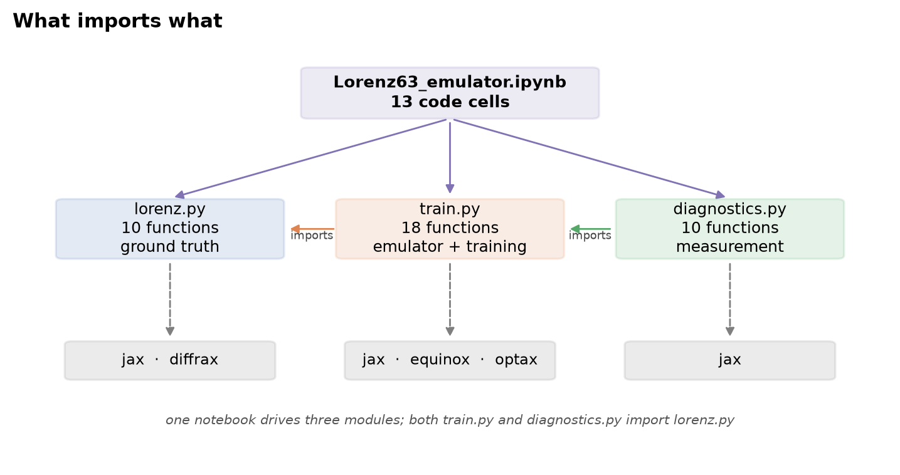
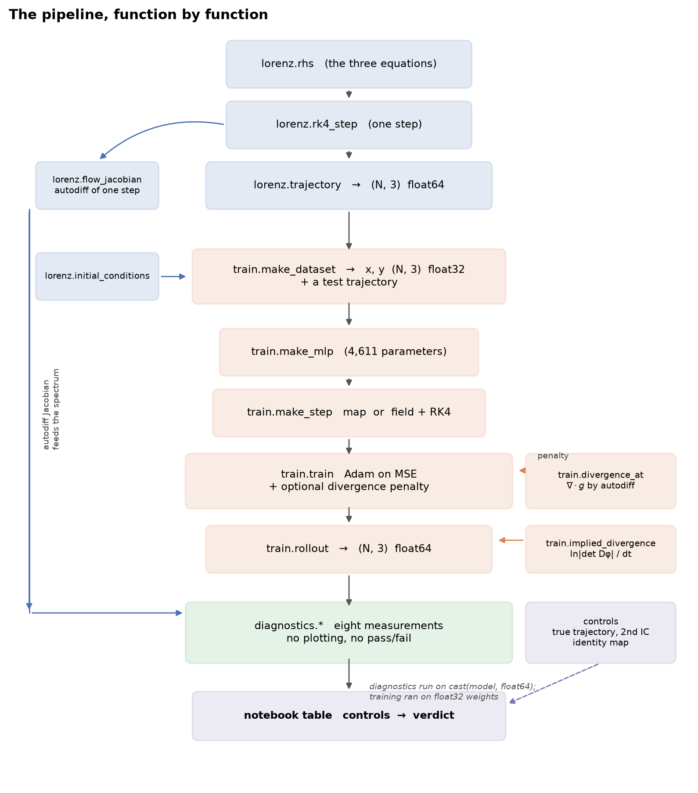
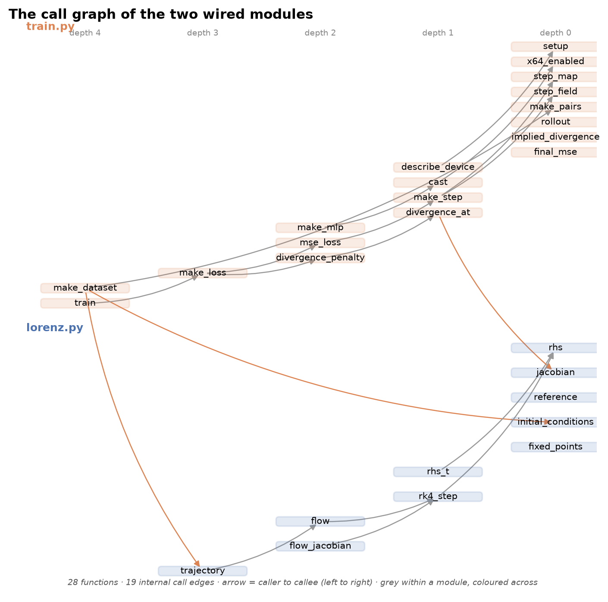
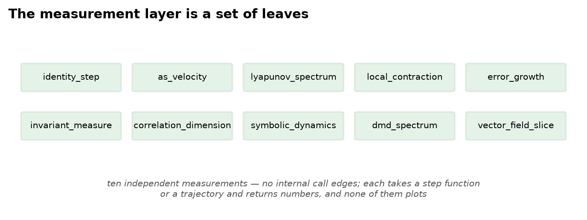
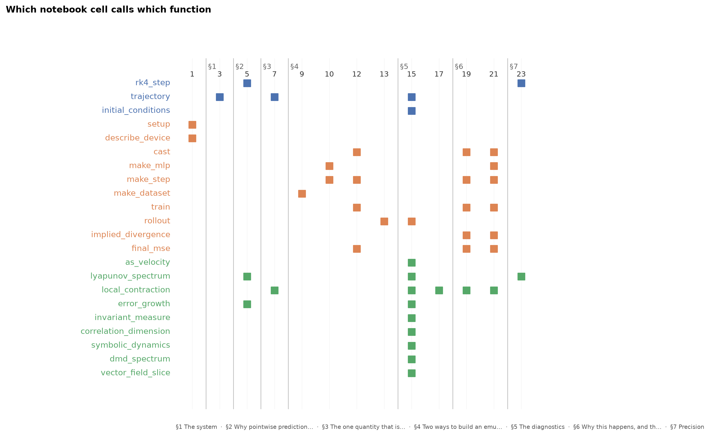

# How the code fits together

### A graphical map of the Lorenz-63 emulator pipeline

This document is a map, not an argument. It shows where every function lives, what calls what,
and how data moves from the equations to a verdict. The science is in [`PAPER.md`](PAPER.md);
the executable version is [`Lorenz63_emulator.ipynb`](Lorenz63_emulator.ipynb).

Everything below is generated from the source by [`scripts/make_pipeline_figures.py`](scripts/make_pipeline_figures.py),
which parses the three modules with Python's `ast` module and reads the notebook's code cells.
The figures cannot drift from the code because they are not drawn by hand.

---

## 1. Four files, three of them code



The notebook is the only entry point. It calls into all three modules, and the three modules
only talk through `lorenz.py`:

| file | functions | role |
|---|---|---|
| [`lorenz.py`](lorenz.py) | 10 | the equations and the integrator — the ground truth |
| [`train.py`](train.py) | 18 | the emulator, the losses, the training loop |
| [`diagnostics.py`](diagnostics.py) | 10 | eight measurements and two utilities |
| [`Lorenz63_emulator.ipynb`](Lorenz63_emulator.ipynb) | 13 code cells | drives all of it, in order |

`train.py` imports `lorenz.py` (to generate trajectories and to differentiate them); `diagnostics.py`
imports `lorenz.py` (for the time step and the true divergence constant). `diagnostics.py` does
**not** import `train.py`, and neither module imports the notebook — the dependency graph is a
tree, so there is no cycle to reason about.

---

## 2. The pipeline in one picture



Read it top to bottom. Each box is a real function; the arrows are data, and the shapes are the
shapes the code actually produces.

1. **`lorenz.rhs`** — the three equations as a function of state.
2. **`lorenz.rk4_step`** — one step of the flow. This is the object the emulator is asked to
   imitate: a map from state to the state one step later.
3. **`lorenz.trajectory`** — apply the step in a loop, discard the transient, return `(N, 3)`.
4. **`train.make_dataset`** — cut trajectories into consecutive pairs `(x_n, x_{n+1})` and add
   noise to the inputs only. Produces `(11996, 3)` pairs in the committed run.
5. **`train.make_mlp`** — a 3→64→64→3 network, 4,611 parameters, in float32.
6. **`train.make_step`** — the one-step function. For the `map` variant it is the network itself;
   for the `field` variant it integrates the network with one RK4 step.
7. **`train.train`** — Adam on next-state error, plus an optional penalty on the field's
   divergence.
8. **`train.rollout`** — apply the learned step repeatedly, in float64.
9. **`diagnostics.*`** — eight measurements, described in section 5.
10. **the notebook table** — the comparisons that turn numbers into a conclusion.

Three branches are worth pointing at:

* **`lorenz.flow_jacobian`** differentiates one step with autodiff and feeds the Lyapunov
  spectrum. It is derived *from* `rk4_step`, not the other way round.
* **`train.divergence_at`** computes the divergence of the learned field, the quantity the
  penalty uses. It exists only because the field parameterisation exposes it.
* **`train.implied_divergence`** computes `ln|det Dφ|/dt` for *any* step function, which is what
  lets the map and field variants be compared on the same axis.

The precision split is drawn as a note rather than a box: weights are trained in float32 and
`train.cast` promotes a copy to float64 before measuring, because a float32 spectrum differs by
a few percent (section 7 of the notebook).

---

## 3. The call graph



The two wired modules hold 28 functions and 19 internal call edges. Functions are laid out by
*call depth*: a function on the left calls functions to its right. Grey arrows stay inside a
module; coloured arrows cross between them.

Three things this layout makes obvious:

* **The chains are short.** The deepest path is `train → make_loss → mse_loss → make_step →
  step_map`, four levels. Nothing is more than four calls from a leaf, which is why the modules
  can be read in one sitting.
* **`make_dataset` reaches into `lorenz.py`, and nothing else does.** Its three coloured edges
  — to `trajectory`, `initial_conditions` and `make_pairs` — are the whole coupling between the
  data pipeline and the physics. The one other cross-module edge, `divergence_at → jacobian`,
  is the training loop asking for a derivative.
* **The far right column is the set of leaves**: `setup`, `step_map`, `step_field`, `rollout`,
  `implied_divergence`, `final_mse`, `rhs`, `jacobian`, and the rest. These are the functions
  that do work without calling anything else in the project.



The measurement layer is deliberately different: **ten functions with no internal edges at
all.** Each takes a step function (or a trajectory) and returns numbers. A diagnostic that
depended on another would be harder to trust and harder to reuse, and one that plotted would
couple measurement to presentation. This is also why `diagnostics.py` can be tested against a
model, a control, or the ground truth without knowing which is which.

## 4. The notebook as a script



Each column is a code cell, in the order it runs; each row is a function that the notebook calls.
Sections are the notebook's own markdown headings.

| section | cells | what happens |
|---|---|---|
| §1 the system | 3 | integrate the equations and draw the attractor |
| §2 why prediction fails | 5 | Lyapunov spectrum of the truth, plus a twin-trajectory check |
| §3 the known invariant | 7 | the constant volume-change rate, per state |
| §4 two ways to emulate | 9–13 | data, model, training, rollout, error saturation |
| §5 the diagnostics | 15–17 | all eight measured on the truth, a second truth, the identity, and the emulator |
| §6 the repair | 19–21 | the field variant without and with the divergence penalty |
| §7 precision | 23 | the same spectrum in float32 and float64 |
| §8 takeaways | — | no code |

The matrix shows the shape of the argument: cells 5 and 7 measure the ground truth, cell 15
measures everything against it, and cells 19 and 21 repeat the measurement on repaired models.
The eight diagnostics are all introduced at cell 15 and then reused — the notebook never
re-implements a measurement.

---

## 5. What each diagnostic needs

All eight live in [`diagnostics.py`](diagnostics.py) and return a dictionary of numbers. None of
them plots, and none decides pass or fail.

| function | input | question it answers | compared against |
|---|---|---|---|
| `lyapunov_spectrum` | step function, start state | how fast does it stretch and squash? | textbook exponents; the sum equals the divergence |
| `local_contraction` | step function, states | where is the volume change wrong? | the constant divergence, at every state |
| `error_growth` | step function, start state | how fast do nearby states separate? | the largest Lyapunov exponent, by a different route |
| `invariant_measure` | two trajectories | does it visit the same regions? | the true trajectory's distribution |
| `correlation_dimension` | one trajectory | is the attractor the right shape? | ≈2.06 for Lorenz-63 |
| `symbolic_dynamics` | one trajectory | does it switch lobes as often? | the true lobe-switch rate |
| `dmd_spectrum` | one trajectory | does its oscillation content match? | the true spectrum's magnitudes |
| `vector_field_slice` | field function, trajectory | does its local rule match off the data? | the true right-hand side |

Two utilities support them: `identity_step` (the floor: a model with no dynamics) and
`as_velocity` (turns a one-step map into the velocity it implies, so map and field emulators can
be compared on the same slice test).

---

## 6. What makes the numbers trustworthy

The diagrams show structure; these are the checks that the structure is measuring something real.
Each is printed by the notebook when it runs.

| check | expected | seen in the committed run |
|---|---|---|
| `sum(λ)` equals `ln|det Dφ|/dt` | exact by construction | agrees to 1e-4 |
| that sum equals the divergence | `−13.667` | `−13.667` |
| true per-state contraction is constant | spread → 0 | spread `9e-5` |
| a second true trajectory reproduces the spectrum | within sampling error | λ₁ `0.937` vs `0.878` |
| the identity map scores at the floor | no growth, no chaos | λ = 0, growth = 0 |
| convergence slope of λ₁ | 0 | `−2e-5` |

The first two are identities that must hold if the Jacobian and the QR recurrence are correct;
they are the reason the spectrum can be trusted without an external reference. The last four are
controls: they give every other number a scale.

---

## 7. Regenerating this document

```bash
python scripts/make_pipeline_figures.py        # writes figures/*.png from the source
python scripts/render_paper.py PIPELINE.md     # writes PIPELINE.html and PIPELINE.pdf
```

The figure generator reads `lorenz.py`, `train.py`, `diagnostics.py` and the notebook with
`ast`, so if a function is renamed or a call is added, re-running it updates the diagrams. If a
new function appears that is not in the layout's ordering table, it will be placed by call depth
but not positioned deliberately — that table is the one hand-maintained part.
