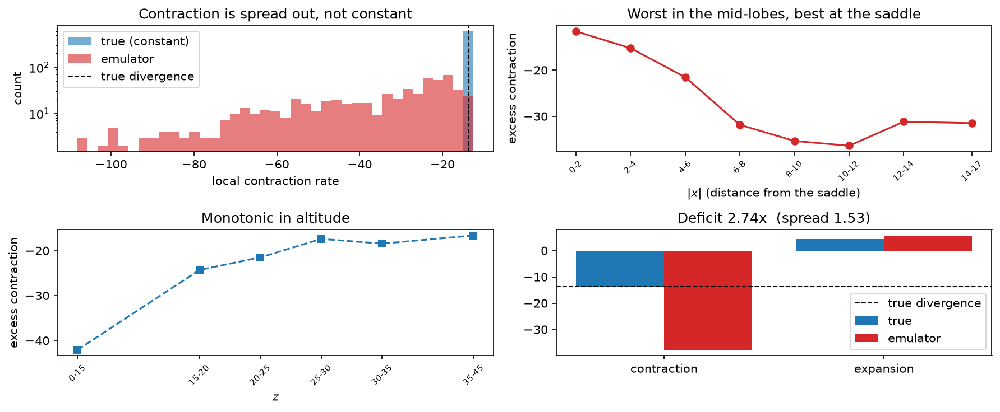

# Predicting the wrong thing correctly

Can a neural network learn a chaotic system's *dynamics*, or only its next state?

A small network is trained to imitate the **Lorenz-63** equations, the standard
model of deterministic chaos. Eight measurements then ask whether it reproduces
the system's dynamics — its Lyapunov spectrum, how fast it destroys volume, the
shape of its attractor, how often it switches lobes — rather than how close its
next guess is.

The answer is that the two come apart. An emulator with near-optimal one-step
error can get the dynamics qualitatively wrong, and the failure is visible only
if you measure the right thing.



*Left: the true system destroys volume at one fixed rate (−13.7) at every point
in space. The emulator's rate is smeared from −14 to −110. Right: the error is
organised, not random — worst far from the saddle point between the lobes.*

## What it shows

| quantity | ground truth | emulator | |
|---|---|---|---|
| one-step error | — | 0.11 | looks fine |
| dominant Lyapunov exponent | +0.88 | −0.01 | chaos destroyed |
| volume contraction | −13.7 | 22× too fast | wrong rate |
| attractor dimension | 2.06 | 0.85 | collapsed |

*Numbers from the full study in [`docs/PAPER.pdf`](docs/PAPER.pdf), at input noise 0.4.
The notebook reproduces the same failure with a smaller model, so its figures differ
in magnitude but not in kind.*

Forecast error notices none of this. The reason is structural: the volume change
enters a one-step prediction only at second order in the timestep — a factor of
100 down at `Δt = 0.01` — so a model trained on next-state error has no reason to
learn it, and a map emulator has no local quantity that could be penalised
anyway. Learning the *velocity field* instead exposes the divergence as a cheap
derivative, and putting it in the loss fixes the contraction to 0.8%.

## Start here

[`Lorenz63_emulator.ipynb`](Lorenz63_emulator.ipynb) — one notebook, executed end
to end, that builds the system from the equations, trains the emulator, measures
all eight properties, finds the failure, and repairs it. No physics background
assumed; runs in about three minutes on a laptop.

## Repository

| path | what |
|---|---|
| [`Lorenz63_emulator.ipynb`](Lorenz63_emulator.ipynb) | the walkthrough |
| [`lorenz.py`](lorenz.py) | the equations, RK4, trajectories, exact Jacobians |
| [`train.py`](train.py) | equinox MLP, losses, optax loop, precision handling |
| [`diagnostics.py`](diagnostics.py) | the eight measurements, all in JAX |
| [`experiments/`](experiments) | three follow-ups on whether the invariant can be learned without being told |
| [`docs/PAPER.pdf`](docs/PAPER.pdf) | the full study: five seeds, controls, error analysis |
| [`figures/`](figures) | figures used here and in the paper |
| [`scripts/render_docs.py`](scripts/render_docs.py) | rebuilds the PDF from its markdown |

About 700 lines of Python across the three modules.

## The three follow-ups

Each is a self-contained script that writes its own results and figures.

**[`step1_scaling.py`](experiments/step1_scaling.py)** — does the timestep
control the divergence error? *No.* The predicted `Δt⁻¹` law is not observed
(slopes +0.31 and +0.05); instead the mismatch is a lottery across seeds
(−21 to −6 against a true −13.7).

**[`step2_data_divergence.py`](experiments/step2_data_divergence.py)** — can the
divergence be estimated from data instead of computed? *Only with the right
data.* From on-attractor pairs the estimate recovers 0.45–0.53 of the true rate;
from off-attractor transients it recovers 0.83–0.95. The transverse contraction
that dominates the divergence is simply not sampled on the attractor.

**[`step3_ensemble_training.py`](experiments/step3_ensemble_training.py)** — can a
cloud of nearby states constrain the contraction without any analytic target?
*Yes, at a fraction of the cost.* Matching the cloud's covariance recovers
contraction to 1.8% for 29% extra one-step error, where the analytic penalty buys
0.1% for 20× the error.

## Running it

```bash
pip install -r requirements.txt
jupyter lab Lorenz63_emulator.ipynb

python experiments/step1_scaling.py
python experiments/step2_data_divergence.py
python experiments/step3_ensemble_training.py
```

**On a GPU.** The code is plain JAX and uses a GPU automatically when one is
visible. On Colab, set the runtime to GPU and install the CUDA build:

```python
!pip install -U "jax[cuda12]" equinox optax
```

Training runs in float32; the diagnostics run in float64, and the notebook
measures the difference.

## Scope

The paper in [`docs/`](docs/PAPER.pdf) describes the full `v1.0` study — an
eight-diagnostic package with five seeds and a three-arm comparison — which is
archived at git tag `v1.0`. This branch is a reduction of it: the notebook, three
modules, and the three follow-up experiments above.
