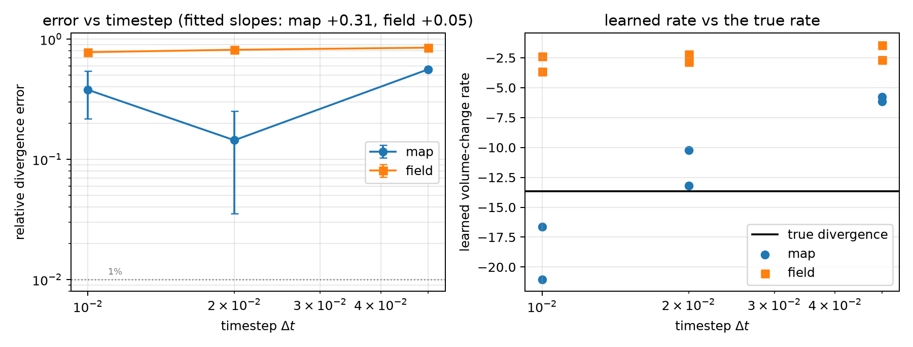
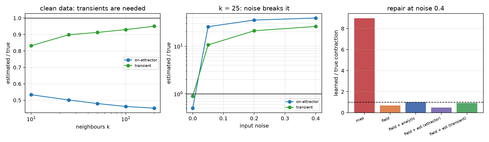
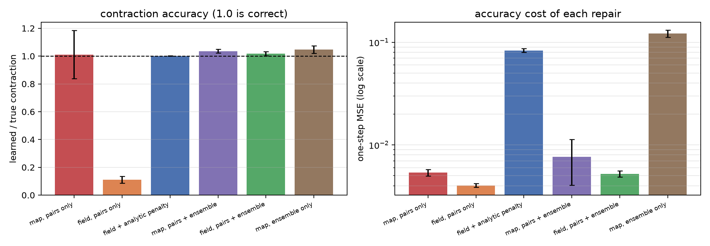

# Steps 1–3: making the divergence learnable without being told the answer

Three experiments that follow the open question in [`docs/PAPER.md`](../docs/PAPER.md) §5.4:
the repair works, but only because the divergence `−13.667` was computed
analytically. Can the same result be reached without being handed the answer?

Both experiments are small on purpose. They are pilots: two seeds, one system, a
4.6k-parameter model. The point is to find out which question is the right one
before spending compute on it.

```bash
python experiments/step1_scaling.py
python experiments/step2_data_divergence.py
python experiments/step3_ensemble_training.py
```

Results are written to `results/*.json`, figures to `figures/`.

---

## Step 1 — does the timestep control the divergence error?

**Hypothesis.** The volume-change rate is the log-determinant of the one-step
Jacobian divided by `Δt`. An error `ε` in that Jacobian therefore produces an
error `ε/Δt` in the learned rate, so the relative divergence error should scale
like **`Δt⁻¹`**.

**Design.** Train a map and a field emulator at `Δt = 0.01, 0.02, 0.05`, holding
the data quantity at ~2,500 pairs and the model at 33k parameters / 80 epochs.
Measure the learned rate against the exact rate of the reference RK4 map at that
`Δt` (not against the ODE divergence — see below).

**The reference has to be checked first.** The RK4 step map's own volume-change
rate is only equal to `−13.667` while the integrator is accurate:

| Δt | step-map rate | drift from the ODE divergence |
|---|---|---|
| 0.01 | −13.667 | 0.0% |
| 0.02 | −13.665 | 0.0% |
| 0.05 | −13.569 | 0.7% |
| 0.10 | −10.847 | **20.6%** |

At `Δt = 0.1` the "ground truth" is not the Lorenz system any more, so that
timestep is excluded from the scaling fit. This bounds the testable range: you
cannot push `Δt` up without changing the integrator.



**Result: the hypothesis fails.** Fitted log-log slopes are **+0.31 (map)** and
**+0.05 (field)**, not `−1`.

| Δt | map error | field error | map learned rate (2 seeds) |
|---|---|---|---|
| 0.01 | 37.9% | 77.9% | −16.6, −21.1 |
| 0.02 | 14.4% | 81.6% | −10.2, −13.2 |
| 0.05 | 56.0% | 85.0% | −6.2, −5.8 |

Two things are more interesting than the failed fit:

1. **The map's divergence is a lottery, not a bias.** Across seeds and timesteps
   the learned rate ranges from **−21.1 to −5.8** against a true `−13.67`. One
   run lands within 3.5%; the next is 56% off. There is no systematic error to
   correct — the objective simply does not constrain the quantity.
2. **The field is systematically wrong in one direction.** Every field run
   under-contracts, landing between **−1.4 and −3.7** (10–27% of the true rate),
   at every timestep. That is the paper's "the field alone does not help",
   reproduced, and it is a *scale* problem: the field is free to be small
   because a small field fits the increments almost as well.

**Conclusion.** The `1/Δt` law is a statement about a lower bound, not about
what training does in practice. In this regime the divergence error is set by
optimisation, not by the timestep. Testing the law properly requires matching
the fit quality across `Δt`, which is the design lesson for anyone repeating it.

---

## Step 2 — can the divergence be estimated from data?

**Design.** Estimate the local Jacobian from `(x_n, x_{n+1})` pairs by a linear
fit over the `k` nearest neighbours, and take `ln|det Ĵ|/Δt`. Then use that
per-state estimate as the penalty target instead of `−13.667`.



### The estimator depends entirely on which data it sees

| neighbourhood cloud | clean data (k=10 → 200) | noise 0.4 |
|---|---|---|
| on-attractor pairs | 0.53 → 0.45 | 39× → 29× |
| transient pairs (off-attractor) | 0.83 → **0.95** | 27× → 12× |

**This is the finding.** From pairs sampled on the attractor, the divergence is
**not identifiable**: the estimate recovers less than half the true rate at every
neighbourhood size. From transients — states still approaching the attractor —
it recovers 83–95%.

The reason is structural rather than numerical. The divergence is dominated by
the strongly contracting direction, `λ₃ ≈ −14.5` out of a total `−13.67`. A
cloud of points on the attractor is locally a two-dimensional sheet, so a local
fit never sees how fast the *transverse* direction contracts. The transverse
derivative is not in the data.

This sharpens the paper's central claim. It is not only that the *loss* cannot
see the divergence; for on-attractor training data, the divergence is **not
determined by the data at all**. The model is free to invent it because the
information is absent, not merely under-weighted.

### A bad target is worse than no target

Repair at input noise 0.4, all measured on the same probe states:

| arm | learned / true contraction |
|---|---|
| map, no penalty | 8.97 |
| field, no penalty | 0.69 |
| field + **analytic** target | **0.998** |
| field + estimate from **transient** pairs | **0.930** |
| field + estimate from **on-attractor** pairs | 0.498 |

The transient estimate has a mean absolute error of 10.3% and drives the repair
to 0.93 — close enough to the analytic result to call the circularity broken, in
a qualified way. The attractor estimate has 52.3% error and makes the model
*worse than leaving it alone* (0.50 vs 0.69). Penalising toward a wrong invariant
is actively harmful.

Under observation noise the estimator collapses (10–27× at `ε = 0.4`): local
linear regression is destroyed by noise in the inputs. So the qualified claim is:
**the repair can be driven from data when the data are clean and include
off-attractor states.**

---

## What this changes for the next step

1. **The open question is data-side, not architecture-side.** "Estimate the
   invariant from data" turns out to be "get data that identifies it". For a
   simulator that is easy; for observations it is the whole problem.
2. **On-attractor-only training is underdetermined.** Any method that claims to
   learn contraction from a long trajectory on the attractor should say how it
   breaks the transverse identifiability — otherwise it is guessing.
3. **The noise failure is the next real obstacle.** The estimator needs an
   errors-in-variables treatment (total least squares, or denoising first), and
   that is a well-posed, self-contained experiment.

## What would falsify this

* A local estimator that recovers the divergence from on-attractor data alone
  would break finding (2). We have not found one, but only one family was tried.
* If a *corrected* estimator (total least squares) recovers the rate at
  `ε = 0.4`, the noise failure is a fixable bias rather than a limit.
* If the same experiment on Rössler behaves differently, the identifiability
  argument is specific to constant-divergence systems, not general.

## Caveats

Two seeds, one system, one estimator family, a 4.6k-parameter model, and a
resolvability test that has not been applied here. These are pilots. The
headline numbers (0.93 vs 0.998, 0.45 vs 0.95) are far larger than the seed
spread in step 1, but they should be repeated with five seeds before being
quoted.


---

## Step 3 — train on a cloud, not a trajectory

Steps 1 and 2 say the divergence is neither constrained by a one-step objective
nor identifiable from on-attractor pairs. Both failures point at the same fix:
give the model more than one state at a time.

**Why an ensemble sees it at first order.** The covariance of a cloud of nearby
states transforms as `C → Dφ C Dφᵀ`, so

```
det C_{n+1} / det C_n = det(Dφ)² = exp(2 Δt ∇·f)
```

At `Δt = 0.01` that is a **24% volume change per step** — a first-order effect,
measured directly, against the second-order term a single trajectory provides.
The run verifies the identity: the true cloud's log-volume changes by
`−0.2733` per step, and `2 Δt ∇·f = −0.2733`.

**Design.** Base states on the attractor, `m = 16` isotropic perturbations of
size `ε = 0.5`, the true one-step image of every member, and a loss that matches
the cloud's mean, covariance and (implicitly) its volume. No analytic divergence
appears anywhere. The ensemble members are off the attractor, which is exactly
the data step 2 found necessary.



Input noise 0.05, three seeds, identical architecture, optimiser and budget:

| arm | contraction ratio | one-step MSE |
|---|---|---|
| map, pairs only | 1.011 ± 0.172 | 0.00538 |
| field, pairs only | 0.111 ± 0.025 | 0.00403 |
| field + **analytic** penalty | **1.001 ± 0.002** | **0.08317** |
| map, pairs + ensemble | 1.035 ± 0.014 | 0.00766 |
| field, **pairs + ensemble** | **1.018 ± 0.015** | **0.00521** |
| map, ensemble only | 1.048 ± 0.027 | 0.12170 |

**The result.** `field + pairs + ensemble` recovers contraction to **1.8%**
without knowing the answer, at **29% more MSE** than the unconstrained field
(0.0052 vs 0.0040). The analytic penalty is more accurate (0.1% error) but costs
**20×** the MSE (0.083 vs 0.0040). So the knowledge-free repair buys almost all
of the accuracy for a small fraction of the price.

Two other readings:

* **The map's spread is the finding, not its mean.** At 1.011 ± 0.172 the
  unconstrained map is right *on average* and wrong by ±17% per seed — the same
  lottery step 1 measured. A mean-only report would call this solved.
* **The two objectives are complementary.** Ensemble-only training gets the
  contraction (1.048) but is 23× worse on accuracy (0.122); pairs-only gets the
  accuracy but loses the contraction. Neither alone is the answer; the sum is.

This is the experiment the PDE-scale paper does not run: they probe with
ensembles but train on unperturbed trajectories.

## What step 3 does not establish

* The ensemble is built from **clean simulated clouds**. A real application may
  not be able to generate off-attractor members, and step 2 shows noisy
  estimation is where this breaks.
* One noise level, one perturbation size, one ensemble size, three seeds.
  Perturbation size is a real knob: too small and curvature dominates, too large
  and the cloud is no longer local.
* Only Lorenz-63. The claim that this transfers to Kolmogorov flow is untested.

## Next, in order

1. Repeat step 3 at input noise 0.4, where the pairs data are bad.
2. Sweep `ε` and `m`: how small a cloud is enough?
3. Port the PDE paper's three probes (error formation, ensemble geometry,
   extreme events) onto Lorenz-63 so the two systems are measured identically.
